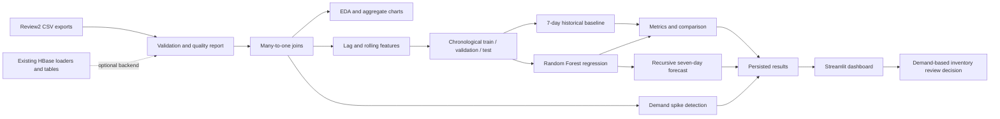

# Retail Demand Lab

## Retail Sales Forecasting and Demand Spike Detection

<p align="center">
	<strong>A full-stack Big Data case study for turning retail history into a seven-day demand planning decision.</strong><br>
	<a href="#case-study-at-a-glance">Case study</a> ·
	<a href="#run-the-project">Run it</a> ·
	<a href="#dashboard">Dashboard</a> ·
	<a href="docs/REVIEW_GUIDE.md">Review guide</a>
</p>

<p align="center">
	
	
</p>

> **Research question:** Can historical product demand, selling price, calendar events, and seasonality predict the next seven days of demand well enough to support inventory planning?

This project is built for an academic Big Data Analytics review. It connects data ingestion, quality checks, exploratory analysis, distributed-processing design, machine learning, anomaly detection, performance measurement, a practical decision, and a Streamlit presentation layer.

<p align="center">
	
	
	
	
</p>

## Case Study At A Glance

| Expected component | How this project addresses it | Evidence |
|---|---|---|
| **1. Real-time data sets** | The supplied data is historical. The project provides a reproducible batch workflow and a clearly labelled seven-day forecast; any future replay of historical rows must be treated as simulated streaming, not live external data. | `Review2/*.csv`, `results/predictions/seven_day_forecast.csv` |
| **2. Preprocessing and EDA** | Validates schemas, numeric fields, nulls, duplicate natural keys, dates, many-to-one joins, missing prices, trends, products, stores, and price relationships. | `analytics/preprocess.py`, `analytics/eda.py`, `results/charts/` |
| **3. Analysis question** | Frames a focused demand-forecasting and inventory-prioritisation question suitable for a 15-minute review. | This README and `docs/REVIEW_GUIDE.md` |
| **4. Spark / PySpark** | The project now has an explicit Spark execution path for DataFrames, window features, chronological evaluation, and Spark MLlib Random Forest. Pandas remains available as a reference engine; no multi-node speedup is claimed. | `run_pipeline.py --engine spark`, `analytics/spark_pipeline.py`, `results/metrics/spark_run_summary.json` |
| **5. Results and visualisation** | Produces seven saved charts plus an interactive Streamlit dashboard for trends, forecasts, spikes, metrics, and recommendations. | `results/charts/`, `dashboard/app.py` |
| **6. Analysis decision** | Prioritise products with high recent or predicted demand for inventory review, while avoiding fabricated stockout or savings claims. | Dashboard and `docs/MODEL_EVALUATION.md` |
| **7. Suitable ML model** | Compares seven transparent demand baselines with a deterministic Random Forest regressor using chronological test metrics. | `analytics/baselines.py`, `analytics/pipeline.py`, `results/metrics/model_metrics.csv` |
| **8. Performance analysis** | Persists MAE, RMSE, WAPE, preprocessing time, training time, prediction time, row counts, and split dates. | `results/metrics/`, `docs/MODEL_EVALUATION.md` |

### Verified dataset

- **505,032** sales observations and **492,504** total units
- **264** products, **1** store, **1** state, and **1,913** relative days
- **204,234** price observations across **282** weeks
- Calendar coverage from **2011-01-29** to **2016-06-19**
- **0** unmatched calendar rows and **96,789** unmatched price rows, reported and imputed rather than silently discarded

The one-store limitation is intentional project evidence: the store-comparison view is included, but the analysis does not pretend that one store supports cross-store conclusions.

## Architecture



The preserved `Review2` Java project loads sales, prices, and calendar records into `retail_sales`, `retail_prices`, and `retail_calendar`. Review3 reads the verified CSV exports for reproducibility and does not modify HBase. The current run reports its actual source and execution mode in `results/metrics/run_summary.json`.

## Run The Project

### 1. Install

```bash
cd ~/Documents/BigData/Review3
python -m venv .venv
.venv/bin/pip install -r requirements.txt
```

The source files remain in `../Review2`; existing loaders, tables, and infrastructure are left intact.

### 2. Execute the analytics pipeline

```bash
.venv/bin/python run_pipeline.py
```

This creates the quality report, joined daily dataset, model, predictions, recursive seven-day forecast, demand-spike records, metrics, and charts.

To execute the Spark path explicitly:

```bash
.venv/bin/python run_pipeline.py --engine spark
```

The Spark run records `engine`, Spark version, master, shuffle partitions, row counts, join counts, and timings in `results/metrics/spark_run_summary.json`. It writes Spark-specific metrics and predictions under `results/metrics/spark_model_metrics.csv` and `results/predictions/spark_test_predictions.csv`.

To run the optional simulated stream:

```bash
.venv/bin/python -m stream.replay --days 28
.venv/bin/python -m stream.stream_job
```

This replays historical rows as JSON micro-batches through Spark Structured Streaming. It is explicitly labelled `simulated_historical_replay`, not live data. Micro-batch summaries and simulated spike records are written under `results/stream/`, with checkpoint state under `results/checkpoints/`.

### 3. Run tests

```bash
.venv/bin/pytest -q
```

### 4. Open the full-stack dashboard

```bash
.venv/bin/streamlit run dashboard/app.py
```

Then visit **[http://localhost:8501](http://localhost:8501)**. The dashboard reads persisted results and does not retrain during normal page rendering.

## Dashboard

The Streamlit application, **Retail Demand Lab**, contains:

- **Overview:** total sales, products, stores, records, date coverage, source, and execution mode
- **Exploratory analysis:** trend, top products, store comparison, and price relationship
- **Forecasting:** product selector, actual-versus-predicted history, and recursive seven-day forecast table
- **Demand spikes:** flagged product-store-date observations, expected demand, score, and explanation
- **Model performance:** baseline versus Random Forest MAE, RMSE, and WAPE
- **Inventory decision support:** demand-based prioritisation without invented inventory quantities or savings
- **Simulated live replay:** historical micro-batches, throughput counts, and an explicit simulated-data warning
- **Model transparency:** persisted Random Forest feature importance

<p align="center">
	
	
	
</p>

## Results And Decision

The model is evaluated on the same chronological test window:

| Model | MAE | RMSE | WAPE |
|---|---:|---:|---:|
| 28-day moving average | **1.0601** | **2.4059** | **0.8926** |
| Random Forest | 1.0699 | 2.4246 | 0.9009 |
| Seasonal naive (7 days) | 1.3281 | 3.3600 | 1.1182 |

The expanded benchmark shows that the **28-day moving average is the strongest measured model on this test window**, narrowly outperforming the current Random Forest. The defensible business decision is therefore:

> **Use the strongest validated forecast, currently the 28-day moving average, as a demand-prioritisation signal for inventory review. Keep Random Forest as a challenger until rolling-origin evaluation demonstrates a durable advantage. Do not convert a forecast into a reorder quantity until current stock, lead time, service level, and supply constraints are available.**

This conclusion is evidence-based and deliberately limited. It does not claim causation from price or events, a live feed, multi-node speedup, stockout probability, or monetary savings.

## Performance Snapshot

Measured local execution from the persisted run summary:

| Stage | Measured time |
|---|---:|
| Preprocessing and feature preparation | approximately 97.8 s |
| Random Forest training | approximately 14.8 s |
| Test prediction | approximately 0.04 s |

These are workstation measurements for the verified local run. They are not a cluster benchmark. The project records input and output row counts so a future Spark or HBase run can be compared fairly.

## Output Map

| Output | Purpose |
|---|---|
| `results/metrics/data_quality.csv` | Input counts, nulls, duplicate keys, and quality checks |
| `results/metrics/model_metrics.csv` | Seven baselines plus Random Forest, scaled and revenue-weighted metrics |
| `results/metrics/demand_bucket_metrics.csv` | Random Forest error by item demand bucket |
| `results/metrics/horizon_metrics.csv` | Rolling-origin error for forecast horizons 1 through 7 |
| `results/metrics/price_availability.csv` | Missing-price rates by product age |
| `results/metrics/feature_importance.csv` | Random Forest feature importance |
| `results/metrics/run_summary.json` | Execution mode, timings, joins, and split dates |
| `results/predictions/test_predictions.csv` | Historical holdout predictions |
| `results/predictions/seven_day_forecast.csv` | Recursive future forecast rows |
| `results/predictions/demand_spikes.csv` | Transparent trailing-window spike records |
| `results/charts/` | EDA and model visualisations |
| `models/random_forest.pkl` | Persisted trained model and feature list |

## Project Structure

```text
Review3/
├── analytics/
│   ├── preprocess.py       # validation, joins, and leakage-safe features
│   ├── pipeline.py         # training, evaluation, forecast, persistence
│   ├── eda.py              # saved visualisations
│   ├── metrics.py          # MAE, RMSE, and zero-safe WAPE
│   ├── spikes.py           # trailing mean/std demand-spike detection
│   └── spark_support.py    # PySpark availability and local session helper
├── dashboard/app.py        # Streamlit full-stack presentation
├── docs/                   # audit, architecture, evaluation, and review guide
├── results/                # generated charts, metrics, and predictions
├── tests/                  # focused unit tests with synthetic fixtures
├── config.py               # paths and run configuration
├── requirements.txt
└── run_pipeline.py
```

## Review Story In 15 Minutes

1. **Problem:** retail teams need a short-horizon demand signal for planning.
2. **Data:** explain the sales, prices, calendar schemas and one-store limitation.
3. **Preprocessing:** show validation, many-to-one joins, missing-price reporting, and feature history.
4. **EDA:** open the trend, top-product, price, and spike charts.
5. **Question:** can demand history and contextual fields beat a simple seven-day baseline?
6. **ML:** explain the chronological split and Random Forest features without leakage.
7. **Dashboard:** show forecast, spikes, metrics, and the decision-support table.
8. **Performance:** compare MAE/RMSE/WAPE and runtime measurements.
9. **Decision:** prioritise demand review, but request inventory and lead-time data before replenishment automation.
10. **Limitations:** distinguish historical batch data, simulated streaming possibilities, and verified versus unavailable HBase connectivity.

## Documentation

- [Project walkthrough: why, how, and who benefits](docs/PROJECT_WALKTHROUGH.md)
- [Project audit](docs/PROJECT_AUDIT.md)
- [Architecture](docs/ARCHITECTURE.md)
- [EDA findings](docs/EDA_FINDINGS.md)
- [Model evaluation](docs/MODEL_EVALUATION.md)
- [HBase status](docs/HBASE_STATUS.md)
- [Faculty review guide](docs/REVIEW_GUIDE.md)

## Honest Scope Notes

- The supplied CSV dataset is historical, not a genuine live real-time feed.
- A replay of historical rows would be **simulated streaming** and must be labelled that way.
- HBase remains the optional NoSQL backend from Review2; Review3 did not alter its tables.
- The default reference run uses Pandas, while `--engine spark` executes the real local Spark path. No distributed Spark speedup is claimed without a multi-node measurement.
- Inventory recommendations are demand-based because inventory levels, lead times, costs, and service targets were not supplied.
